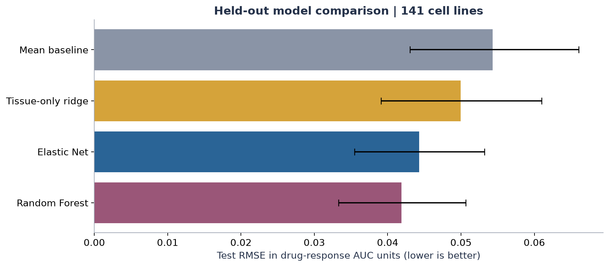

# Erlotinib response prediction from gene expression

A research portfolio project prepared for **Hamza Ahmed**, with AI assistance.

**Question:** can pretreatment gene expression predict drug-response AUC in held-out cancer cell lines and improve on simple baselines?

Start with [Research_Summary.md](Research_Summary.md), or open the downloaded [Research_Report.html](Research_Report.html) in a browser. The [executed notebook](Erlotinib_Response_Study.ipynb) includes code, saved figures and verification. Read the [learning guide](docs/learning_guide.md) to practice explaining the work.

## Held-out results
| Model | Test RMSE | Test R-squared |
|---|---:|---:|
| Training mean | 0.0543 | -0.002 |
| Tissue-only ridge | 0.0499 | 0.153 |
| Elastic Net | 0.0443 | 0.334 |
| Random Forest | 0.0419 | 0.404 |

Random Forest was selected from development CV before test evaluation. Its paired RMSE difference versus tissue-only ridge was -0.0080 (95% conditional bootstrap interval -0.0119 to -0.0039). Lower RMSE is better. These are regression errors, not accuracy percentages. The model still misses some relatively sensitive models; see the prediction/error plot in the report.

## Design
- GDSC2 release 8.5 erlotinib responses joined to frozen Sanger/Broad FPKM expression and Cell Model Passports identities.
- 701 eligible cell lines; 560 development and 141 held-out test models.
- One concentration window: 0.002001–2 micromolar. Drug-response AUC is not classification ROC AUC.
- Four comparisons: training mean, tissue-only ridge, expression Elastic Net and expression Random Forest.
- Five-fold grouped development CV with train-only preprocessing. Model-family selection precedes test evaluation.
- Complete test predictions, paired bootstrap intervals, negative results and limitations retained.

See the [frozen analysis plan](docs/analysis_plan.md), [sources](docs/sources.md), and `results/` for exact metrics and audit records. This is internal validation on laboratory cell models, with no independent external or clinical validation.

## Files
| Path | Purpose |
|---|---|
| `Erlotinib_Response_Study.ipynb` | Executed companion notebook; optionally reruns analysis |
| `Research_Report.html` | Portable, readable notebook export with embedded figures |
| `Research_Summary.md` | Main results and their limits |
| `docs/` | Frozen methods, sources, and learning guide |
| `metadata/source_receipt.json` | Official source URLs and downloaded-file checksums |
| `results/` | Eligibility audit, frozen split, every tuning score, predictions, intervals and figures |
| `scripts/` | Reproducible download, preparation, modeling, validation and notebook creation |
| `requirements-lock.txt` | Exact environment dependency versions |
| `reproduce.ps1` | Windows reproduction entry point |

## Reproduce
Use **Python 3.12**. In PowerShell, run `./reproduce.ps1 -PythonExe 'path/to/python.exe'` from the project folder. The script creates `.venv`, installs pinned dependencies, downloads official inputs, and runs the complete workflow. The downloader retrieves only the FPKM member of the 866 MB source archive (approximately 52 MB compressed), checks the ZIP CRC, and retains a SHA-256 receipt. All required source transfers total approximately 75 MB, expanding to approximately 250 MB; allow at least 2 GB for environment, caches, models and results. Several GB of available RAM are useful. Model tuning can take several minutes or longer depending on hardware.

The shareable ZIP excludes `data/`, `.venv/` and `models/`; the downloader regenerates source data, and the model stage regenerates fitted model files. The project was executed using an adjacent existing Python environment, whose versions are recorded in `metadata/environment.json`.

Use a copy for reproduction: regenerated model and report outputs replace existing files, while a changed frozen split or source hash stops the workflow. Setting `DRUG_DATA_DIR` allows a different local data directory. `-SkipDownload` is only for a complete existing data directory. The default notebook independently verifies and plots saved outputs; switch its `RUN_FULL_ANALYSIS` variable to `True` to repeat model fitting.

## Attribution
Data originate from Sanger/GDSC and Broad/CCLE resources. See source URLs and reuse notes in [docs/sources.md](docs/sources.md). Code, analysis and documentation were prepared with AI assistance. This is not a published paper, clinical tool, wet-lab experiment or claim of independent biomarker discovery. Explain your own contribution accurately when presenting the work.

## Related research projects

- [Project 1: TCGA-LUAD expression and survival](https://github.com/HamzaAhmed-bio/tcga-luad-expression-survival)
- [Project 3: Single-cell lung cancer](https://github.com/HamzaAhmed-bio/single-cell-lung-cancer)
